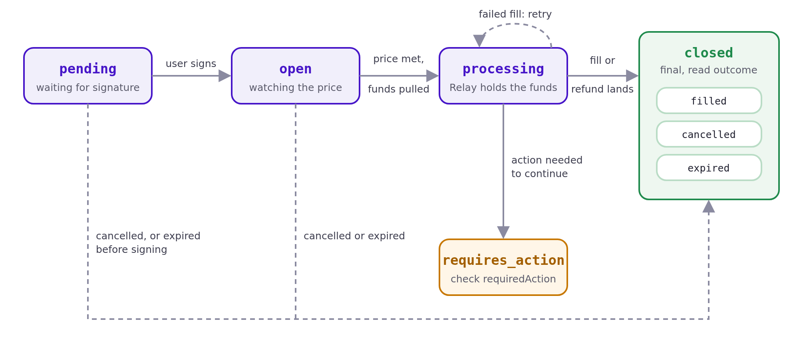

<Warning>
**Closed beta.** Limit orders are available to invited integrators only. This guide and the API it describes can change before general availability.
</Warning>

Limit orders let your users sell or buy a token at a price they choose. The user signs once and their funds stay in their wallet while the order waits. When the market reaches the limit, Relay pulls the funds with the signed permit and a solver fills the order, on the same chain or across chains.

In this walkthrough you'll place a cross-chain order: sell 0.01 WETH on Base for USDG on Robinhood Chain once 1 WETH is worth at least $4,000 after fees. You'll create the order, sign it, and track it until it closes. Each step shows the Relay SDK and the API. Every endpoint, field, and error code is in the [Limit Orders API Reference](/limit-orders/api-reference).

## How a limit order works



| Status | What it means | What the user can do |
| --- | --- | --- |
| `pending` | Created and waiting for the user's signature. No funds move. | Sign or cancel. |
| `open` | Signed. Relay is watching the price, and the funds are still in the user's wallet. | Cancel, except for the few seconds while Relay pulls the funds. |
| `processing` | The price was met and Relay holds the funds: a fill or a refund is under way, or Relay is retrying after a failed fill. | Wait. An order that is retrying after a failed fill can be cancelled; it is refunded first. |
| `requires_action` | The order needs an action before it can continue. `requiredAction` says which one. | Check [`requiredAction`](/limit-orders/api-reference#required-actions). |
| `closed` | Final. `outcome` says how the order ended: `filled`, `cancelled`, or `expired`. See [Outcomes](#outcomes). | Nothing. |

1. **Create.** You send the order to [`POST /orders`](/limit-orders/create-order). Relay checks it, prices it, and returns it as `pending` with the steps the user has to complete.
2. **Sign.** The user approves Permit2 for the token (once per token) and signs the order's Permit2 permit, which you post to [`POST /orders/{orderId}/signature`](/limit-orders/sign-order). Relay verifies the signature and the order becomes `open`. No funds move.
3. **Watch.** Relay checks the all-in price periodically.
4. **Fill.** When the price meets the limit, Relay pulls the funds with the permit and a solver fills the order. The order is `processing`.
5. **Close.** The order becomes `closed` with an `outcome`: `filled`, `cancelled`, or `expired`.

An order lives for at least 15 minutes and at most 7 days, set by `expiresAt`.

<Steps>
  <Step title="Configure">
    **Prerequisites:**

    - **Base URL:** `https://api.relay.link`
    - **API key with limit orders enabled:** Relay enables limit orders per app during the closed beta. Ask your Relay contact to enable your app, then send its key in the `x-api-key` header on every orders request.
    - **Environment:** Node.js 20 or later, with [viem](https://viem.sh). For the SDK path, also install `@relayprotocol/relay-sdk`.
    - **Wallet:** an EVM wallet holding the token it sells (here at least 0.01 WETH on Base), plus a little ETH on Base for the one-time Permit2 approval.

    <Callout icon="key" color="#4615C8">
    **API key permissions**

    - **Create** and **sign** need an active key whose app has limit orders enabled. Otherwise they return `403 FORBIDDEN`.
    - **List** and **cancel** accept any active key of your app.
    - Orders belong to your app, not to the key that created them. Any of your keys can read and cancel them, and open orders keep running when you rotate a key.
    </Callout>

    ### Set up the SDK

    Install and configure the SDK as described in [Installation](/references/relay-kit/sdk/installation) and [createClient](/references/relay-kit/sdk/createClient). The order actions are on `getClient().actions`: `createOrder`, `getOrders`, `signOrder`, `cancelOrder`, and `executeOrder`. If you proxy requests to keep your API key off the client, make the proxy forward the `Idempotency-Key` header too.

    ### Currencies

    An order has a **`targetCurrency`** on **`targetChainId`**, the token being traded, and a **`settlementCurrency`** on **`settlementChainId`**, the stablecoin it is priced and paid in. **`side`** decides which one the user spends:

    | `side` | The user spends | The recipient receives |
    | --- | --- | --- |
    | `sell` | `targetCurrency` on `targetChainId` | `settlementCurrency` on `settlementChainId` |
    | `buy` | `settlementCurrency` on `settlementChainId` | `targetCurrency` on `targetChainId` |

    These rules apply during the beta:

    - **The currency spent must be an ERC-20 on an EVM chain**, because the order is authorized with Permit2. Native currencies aren't supported on either side; use the wrapped token, such as WETH.
    - **The settlement currency must be an accepted stablecoin that Relay holds on its chain**, such as USDC, USDT, or USDG. Relay values it at exactly $1 when it compares the price with your limit.
    - **On a buy, the target must be a currency Relay holds on its chain.** These are listed under `solverCurrencies` in [GET /chains](/references/api/get-chains).
    - **On a sell, the target can be any ERC-20 on its chain.** A token Relay doesn't hold is swapped on the origin chain first, on chains that support it.

    For currency pickers, we recommend reading `solverCurrencies` from `/chains` and leaving out the native currency:

    ```bash
    curl -s "https://api.relay.link/chains" | jq '.chains[] | select(.id == 4663) | .solverCurrencies[] | {symbol, address}'
    ```
  </Step>
  <Step title="Create the order">
    Create the order with [`POST /orders`](/limit-orders/create-order), which returns the order with the steps the user still has to complete. Nothing happens onchain until the user signs.

    ### Request

    Sell 0.01 WETH on Base for USDG on Robinhood Chain (chain id `4663`) once 1 WETH is worth at least $4,000 after fees, with the order expiring in 24 hours. The target and settlement currencies are on different chains, so the order is cross-chain. The user spends WETH on Base, where every step runs, and the recipient receives USDG on Robinhood Chain:

    <CodeGroup>
    ```typescript SDK
    import { getClient } from '@relayprotocol/relay-sdk'

    // Without a wallet, createOrder returns the pending order and its steps
    const order = await getClient().actions.createOrder({
      idempotencyKey: crypto.randomUUID(),
      order: {
        type: 'limit',
        user: 'WALLET_ADDRESS',
        side: 'sell',
        targetCurrency: '0x4200000000000000000000000000000000000006', // WETH on Base
        targetChainId: 8453,
        settlementCurrency: '0x5fc5360d0400a0fd4f2af552add042d716f1d168', // USDG on Robinhood Chain
        settlementChainId: 4663,
        targetPrice: '4000',
        amount: '10000000000000000', // 0.01 WETH
        expiresAt: new Date(Date.now() + 24 * 60 * 60 * 1000).toISOString(),
        clientOrderId: 'my-order-123'
      }
    })

    console.log(order.id, order.status, order.steps) // "pending"
    ```

    ```bash API
    # Replace EXPIRES_AT with an RFC 3339 time 15 minutes to 7 days from now
    curl -X POST "https://api.relay.link/orders" \
      -H "Content-Type: application/json" \
      -H "x-api-key: YOUR_API_KEY" \
      -H "Idempotency-Key: 6b1f0f6e-0c1e-4a52-9a3c-0f6a1d2b7c11" \
      -d '{
        "type": "limit",
        "user": "WALLET_ADDRESS",
        "side": "sell",
        "targetCurrency": "0x4200000000000000000000000000000000000006",
        "targetChainId": 8453,
        "settlementCurrency": "0x5fc5360d0400a0fd4f2af552add042d716f1d168",
        "settlementChainId": 4663,
        "targetPrice": "4000",
        "amount": "10000000000000000",
        "expiresAt": "EXPIRES_AT",
        "clientOrderId": "my-order-123"
      }'
    ```
    </CodeGroup>

    The fields that define the order:

    | Field | Description |
    | --- | --- |
    | **targetPrice** | USD per 1 whole unit of the target, **all-in**: after Relay's fees, gas, and your app fees. On a sell it is the minimum net proceeds per unit; on a buy, the maximum total cost per unit. A decimal string with up to 18 decimal places. |
    | **amount** | Base units of the currency spent: the target on a sell, the settlement currency on a buy. Here `10000000000000000` is 0.01 WETH. |
    | **expiresAt** | RFC 3339 time, at least 15 minutes and at most 7 days from now. The clock starts at create, not at signing. |
    | **recipient**, **refundTo** | Optional. Who receives the output and who receives refunds. Both default to `user`. |
    | **clientOrderId** | Optional. Your own id for the order, 1–128 characters, usable once. |
    | `Idempotency-Key` header (`idempotencyKey` in the SDK) | Optional. Makes a retried create safe; see Step 5. |

    ### Response

    The API returns `{ order }`, a `pending` order with its `steps`; the SDK returns the order itself:

    ```json Example order expandable
    {
      "order": {
        "id": "order_id_3f9a1c52-7d0e-4b8a-9a61-2f4e8c1d7b90",
        "clientOrderId": "my-order-123",
        "orderHash": "0x5c1e...",
        "type": "limit",
        "status": "pending",
        "outcome": null,
        "cancellationReason": null,
        "requiredAction": null,
        "user": "WALLET_ADDRESS",
        "recipient": "WALLET_ADDRESS",
        "refundTo": "WALLET_ADDRESS",
        "side": "sell",
        "targetCurrency": "0x4200000000000000000000000000000000000006",
        "targetChainId": 8453,
        "settlementCurrency": "0x5fc5360d0400a0fd4f2af552add042d716f1d168",
        "settlementChainId": 4663,
        "targetPrice": "4000",
        "originChainId": 8453,
        "originCurrency": "0x4200000000000000000000000000000000000006",
        "destinationChainId": 4663,
        "destinationCurrency": "0x5fc5360d0400a0fd4f2af552add042d716f1d168",
        "amount": "10000000000000000",
        "fees": { "gas": { ... }, "relayer": { ... }, "app": { ... } },
        "createdAt": "2026-11-15T12:00:00.000Z",
        "updatedAt": "2026-11-15T12:00:00.000Z",
        "expiresAt": "2026-11-16T12:00:00.000Z",
        "closedAt": null,
        "requestIds": [],
        "filledAmount": "0",
        "refundedAmount": "0",
        "withdrawnAmount": "0",
        "latestPriceCheck": null,
        "steps": [
          {
            "id": "approve",
            "action": "Confirm transaction in your wallet",
            "description": "Sign an approval for WETH",
            "kind": "transaction",
            "status": "incomplete",
            "data": {
              "from": "WALLET_ADDRESS",
              "to": "0x4200000000000000000000000000000000000006",
              "data": "0x095ea7b3...",
              "value": "0",
              "chainId": 8453
            }
          },
          {
            "id": "authorize",
            "action": "Sign authorization",
            "description": "Sign to approve transfer of WETH",
            "kind": "signature",
            "status": "incomplete",
            "data": {
              "sign": {
                "signatureKind": "eip712",
                "domain": {
                  "name": "Permit2",
                  "chainId": 8453,
                  "verifyingContract": "0x000000000022D473030F116dDEE9F6B43aC78BA3"
                },
                "types": { ... },
                "primaryType": "PermitBatchWitnessTransferFrom",
                "value": { ... }
              },
              "post": {
                "endpoint": "/orders/order_id_3f9a1c52-7d0e-4b8a-9a61-2f4e8c1d7b90/signature",
                "method": "POST",
                "body": {}
              }
            },
            "check": {
              "endpoint": "/orders?orderId=order_id_3f9a1c52-7d0e-4b8a-9a61-2f4e8c1d7b90",
              "method": "GET"
            }
          }
        ]
      }
    }
    ```

    Before it quotes, create checks that:

    - the currencies follow the rules in Step 1;
    - `expiresAt` is between 15 minutes and 7 days away;
    - the wallet has fewer than **100** orders that are `open` or `processing`, counted across all integrators (`pending` orders don't count);
    - those orders are on fewer than **50** token pairs, unless the new order is on a pair the wallet already trades;
    - the wallet holds at least `amount` of the currency it spends right now. The balance isn't reserved, so two orders can rely on the same funds.

    Each failed check returns an `errorCode`; see [Errors](/limit-orders/api-reference#errors). In the SDK, a failed request throws an `APIError`; read the code from `error.rawError.errorCode`.
  </Step>
  <Step title="Execute (sign the order)">
    Each step in the order's `steps` array carries its own `status`, `data`, and `check`; see [Steps](/limit-orders/api-reference#steps) for when each one appears. Run the `incomplete` steps in order:

    - **`approve`** (`transaction`): approves Permit2 to spend the token. It appears only when the wallet hasn't approved Permit2 for this token yet. Send it and wait for the receipt.
    - **`authorize`** (`signature`, EIP-712): the Permit2 permit that lets Relay pull the funds once the price is met. Sign `data.sign`, then post `data.post.body` to `data.post.endpoint` ([Sign an order](/limit-orders/sign-order)) with the signature in the `signature` query parameter. The response is the order, now `open`.

    The SDK runs both steps for you: pass the order and a wallet to `executeOrder`. To create and sign in one call, pass `wallet` to `createOrder` instead.

    <CodeGroup>
    ```typescript SDK expandable
    // npm install @relayprotocol/relay-sdk viem
    import { createClient, convertViemChainToRelayChain, getClient, MAINNET_RELAY_API } from '@relayprotocol/relay-sdk'
    import { createWalletClient, http } from 'viem'
    import { privateKeyToAccount } from 'viem/accounts'
    import { base } from 'viem/chains'

    // 1. Set up the client and a wallet on the order's origin chain (Base)
    createClient({
      baseApiUrl: MAINNET_RELAY_API,
      apiKey: 'YOUR_API_KEY', // server-side only
      chains: [convertViemChainToRelayChain(base)]
    })
    const account = privateKeyToAccount('0xYOUR_PRIVATE_KEY')
    const wallet = createWalletClient({ account, chain: base, transport: http() })

    // 2. Create the order and run its steps: the approval if needed, then the signature
    const order = await getClient().actions.createOrder({
      idempotencyKey: crypto.randomUUID(),
      order: {
        type: 'limit',
        user: account.address,
        side: 'sell',
        targetCurrency: '0x4200000000000000000000000000000000000006', // WETH on Base
        targetChainId: 8453,
        settlementCurrency: '0x5fc5360d0400a0fd4f2af552add042d716f1d168', // USDG on Robinhood Chain
        settlementChainId: 4663,
        targetPrice: '4000',
        amount: '10000000000000000', // 0.01 WETH
        expiresAt: new Date(Date.now() + 24 * 60 * 60 * 1000).toISOString()
      },
      wallet,
      onProgress: ({ steps }) => console.log(steps.map((step) => step.id + ': ' + step.items[0].status))
    })

    console.log('Order ' + order.id + ' is ' + order.status) // "open"

    // To sign an order created earlier without a wallet, run its steps instead:
    // await getClient().actions.executeOrder({ order: pendingOrder, wallet })
    ```

    ```typescript API expandable
    // npm install viem
    import { createPublicClient, createWalletClient, http } from 'viem'
    import { privateKeyToAccount } from 'viem/accounts'
    import { base } from 'viem/chains'

    const API = 'https://api.relay.link'
    const headers = { 'Content-Type': 'application/json', 'x-api-key': 'YOUR_API_KEY' }

    // 1. Set up the wallet on the order's origin chain (Base)
    const account = privateKeyToAccount('0xYOUR_PRIVATE_KEY')
    const wallet = createWalletClient({ account, chain: base, transport: http() })
    const publicClient = createPublicClient({ chain: base, transport: http() })

    async function placeOrder() {
      // 2. Create the order
      const res = await fetch(API + '/orders', {
        method: 'POST',
        headers: { ...headers, 'Idempotency-Key': crypto.randomUUID() },
        body: JSON.stringify({
          type: 'limit',
          user: account.address,
          side: 'sell',
          targetCurrency: '0x4200000000000000000000000000000000000006', // WETH on Base
          targetChainId: 8453,
          settlementCurrency: '0x5fc5360d0400a0fd4f2af552add042d716f1d168', // USDG on Robinhood Chain
          settlementChainId: 4663,
          targetPrice: '4000',
          amount: '10000000000000000', // 0.01 WETH
          expiresAt: new Date(Date.now() + 24 * 60 * 60 * 1000).toISOString()
        })
      })
      const created = await res.json()
      if (!res.ok) throw new Error(created.errorCode + ': ' + created.message)
      let order = created.order

      // 3. Run the steps in order
      for (const step of order.steps) {
        if (step.status === 'complete') continue

        if (step.kind === 'transaction') {
          // approve: send it and wait for the receipt before signing
          const hash = await wallet.sendTransaction({
            to: step.data.to,
            data: step.data.data,
            value: BigInt(step.data.value ?? 0)
          })
          await publicClient.waitForTransactionReceipt({ hash })
        } else {
          // authorize: sign the Permit2 permit, then post the signature
          const { domain, types, primaryType, value } = step.data.sign
          const signature = await wallet.signTypedData({ domain, types, primaryType, message: value })
          const { endpoint, method, body } = step.data.post
          const signed = await fetch(API + endpoint + '?signature=' + signature, {
            method,
            headers,
            body: JSON.stringify(body) // an empty JSON object
          }).then((r) => r.json())
          if (!signed.order) throw new Error(signed.errorCode + ': ' + signed.message)
          order = signed.order
        }
      }

      console.log('Order ' + order.id + ' is ' + order.status) // "open"
    }

    placeOrder()
    ```
    </CodeGroup>

    Keep these in mind when you run the steps:

    - **Switch the wallet to `order.originChainId` first.** Every step runs on the chain of the currency spent. The SDK checks the wallet's chain but doesn't switch it for you.
    - **Post the signature with a JSON body.** Send `{}` with `Content-Type: application/json`; an empty body with that content type is rejected. The SDK does this for you.
    - **The signature must come from `user`.** Any other signer returns `400 INVALID_SIGNATURE`.
    - **Signing counts toward the caps.** It returns `400 MAX_OPEN_ORDERS_REACHED` or `400 MAX_OPEN_ORDER_PAIRS_REACHED` if the wallet reached a cap after create.
    - **Posting the same signature twice returns `409 ORDER_ALREADY_SIGNED`.** The order is already open, so treat it as success, for example when you retry a post whose response you lost.
    - **An unsigned order closes as `expired`** at `expiresAt`.
    - **To resume an abandoned order,** read it with `getOrders` ([`GET /orders?orderId=`](/limit-orders/list-orders)) and run its steps again with `executeOrder`. A `pending` order keeps its steps.
    - **If you collect the signature yourself,** for example from a wallet your backend doesn't control, submit it with `signOrder({ orderId, signature })`; see [Sign an order](/limit-orders/sign-order).
  </Step>
  <Step title="Monitor">
    Read the order until `status` is `closed`, then read its `outcome`. To show a wallet's active orders, [list them](/limit-orders/list-orders) by `user` and `status`:

    <CodeGroup>
    ```typescript SDK
    import { getClient } from '@relayprotocol/relay-sdk'

    // One order
    const { orders: [order] } = await getClient().actions.getOrders({
      orderId: 'order_id_3f9a1c52-7d0e-4b8a-9a61-2f4e8c1d7b90'
    })

    // A wallet's active orders, newest first
    const { orders, continuation } = await getClient().actions.getOrders({
      user: 'WALLET_ADDRESS',
      status: ['open', 'processing'],
      limit: 20
    })
    ```

    ```bash API
    # One order
    curl "https://api.relay.link/orders?orderId=order_id_3f9a1c52-7d0e-4b8a-9a61-2f4e8c1d7b90" \
      -H "x-api-key: YOUR_API_KEY"

    # A wallet's active orders, newest first
    curl "https://api.relay.link/orders?user=WALLET_ADDRESS&status=open,processing&limit=20" \
      -H "x-api-key: YOUR_API_KEY"
    ```
    </CodeGroup>

    Both return `{ orders, continuation }`. Pass `continuation` back to read the next page. For live updates, use the `order.updated` webhook below instead of polling. If you do poll, every 5–10 seconds while the user is looking at an order is plenty.

    ### Webhooks

    Relay sends an `order.updated` webhook each time an order's history gets a new entry: a status change, a movement of its funds, or a notable price check. The user is often away when an order fills, so we recommend webhooks over polling.

    **Configuration.** Contact the Relay team to set up `order.updated` webhooks for your app; they can't be configured in the Dashboard yet. Send the HTTPS endpoint URL that should receive them, and any custom headers to include on each request.

    **Payload.** Each webhook carries the order as it is when the webhook is sent, in the same shape the API returns, and exactly one new history entry:

    ```json
    {
      "event": "order.updated",
      "timestamp": 1794931260000,
      "data": {
        "order": {
          "id": "order_id_3f9a1c52-7d0e-4b8a-9a61-2f4e8c1d7b90",
          "status": "processing",
          "outcome": null,
          "requestIds": ["0x8a9b3c..."],
          "updatedAt": "2026-11-15T14:21:00.000Z"
        },
        "entry": {
          "id": "event_1042",
          "createdAt": "2026-11-15T14:21:00.000Z",
          "type": "fill",
          "state": "started",
          "recordId": "0x8a9b3c..."
        }
      }
    }
    ```

    The `order` above is shortened; webhooks carry the full Order object. `entry.type` decides the entry's other fields; see [Webhook: order.updated](/limit-orders/webhook) for every entry type and when Relay sends it.

    **Verification.** Webhooks are signed like every Relay webhook: an `X-Signature-Timestamp` header and an `X-Signature-SHA256` header holding the HMAC-SHA256 of `<timestamp>.<body>`, keyed with one of your app's active API keys. Check the signature against each active key of the app, and reject requests that fail with a non-2xx status. See [Webhooks](/references/api/api_guides/webhooks#verification) for a verification example.

    **Handle deliveries.**

    - Relay retries a failed delivery with exponential backoff, and delivers each entry once per endpoint. Entry ids are unique within an order, so drop duplicates on the pair of `data.order.id` and `entry.id`.
    - Webhooks can arrive out of order. Order entries by `entry.createdAt`, and keep the `order` with the latest `updatedAt` as the current state.
    - Relay doesn't send entries from before an endpoint subscribed to `order.updated`. Read the order with [`GET /orders?orderId=`](/limit-orders/list-orders) to catch up.
    - Respond with a 2xx quickly and do slow work afterwards.

    ### Why hasn't my order filled?

    Every order carries `latestPriceCheck`, the result of Relay's latest price check, so you can show progress and explain a wait:

    | Field | Description |
    | --- | --- |
    | **marketPrice** | USD per whole unit of the target before Relay's and your app's fees. |
    | **allInPrice** | USD per whole unit of the target after all fees. This is what Relay compares with `targetPrice`. |
    | **reason** | Why the order didn't fill at this check, or `null` when nothing stopped it. |
    | **checkedAt** | When the check ran. |

    | `reason` | What it means | What to show |
    | --- | --- | --- |
    | `insufficient_balance` | The wallet holds less than `amount` of the currency it spends. | Ask the user to top up. |
    | `insufficient_allowance` | The wallet's Permit2 allowance for the token is below `amount`. | Ask the user to approve Permit2 again. |
    | `no_route` | No route can currently quote the order. | That the order is waiting for liquidity. |
    | `price_not_reached` | The all-in price hasn't reached `targetPrice`. | The distance between `allInPrice` and `targetPrice`. |

    When more than one applies, `reason` is the first in the table: Relay checks balance and allowance before the route and the price. The prices are still filled in whenever the order could be quoted, so you can show the distance to the limit while asking the user to fix their balance.

    `latestPriceCheck` is `null` until the first check. An order short of balance or allowance doesn't trigger: it stays `open` and fills once the user fixes it, if the price is still met before `expiresAt`.

    ### Outcomes

    | `outcome` | What it means |
    | --- | --- |
    | `filled` | The order filled. `filledAmount` is what the recipient received, in base units of the destination currency. |
    | `cancelled` | The order was cancelled. `cancellationReason` is `requested` when you cancelled it, or `access_revoked` when your app lost access to limit orders. |
    | `expired` | `expiresAt` passed before the order filled, or before it was signed. |

    `outcome` and `cancellationReason` are `null` until the order closes. A `cancelled` or `expired` order whose funds Relay had already pulled shows what came back in `refundedAmount`. `requestIds` lists the Relay requests that moved the order's funds; include them when you contact support.

    <Info>
    **When a fill doesn't go through.** If a fill fails after Relay has pulled the funds, Relay keeps them and retries. The order stays `processing` until it fills, is cancelled, or reaches `expiresAt`; then the funds are refunded and the order closes as `cancelled` or `expired`, with the amount in `refundedAmount`. If Relay can't pull the funds at all, for example because the user spent them or revoked the approval, the order stays `open` and Relay keeps watching.
    </Info>

    ### Cancel an order

    There are two kinds of cancel:

    - **Soft cancel (default).** The order closes at once as `cancelled` with `cancellationReason: "requested"`. It costs no gas, and Relay never uses the signature.
    - **Onchain cancel.** The order closes the same way and also returns a `cancel` transaction step that burns the permit's Permit2 nonce, so nobody can ever use the signature. With a `wallet`, the SDK sends it for you; with the API, send it like the `approve` step. It appears only while the permit is still valid and Relay hasn't used it, and it stays `incomplete` after you send it.

    <CodeGroup>
    ```typescript SDK
    import { getClient } from '@relayprotocol/relay-sdk'

    // Soft cancel
    await getClient().actions.cancelOrder({ orderId: 'order_id_3f9a1c52-7d0e-4b8a-9a61-2f4e8c1d7b90' })

    // Onchain cancel: also sends the Permit2 nonce invalidation from the wallet
    await getClient().actions.cancelOrder({
      orderId: 'order_id_3f9a1c52-7d0e-4b8a-9a61-2f4e8c1d7b90',
      onchain: true,
      wallet
    })
    ```

    ```bash API
    # Soft cancel; send {"onchain": true} for an onchain cancel
    curl -X POST "https://api.relay.link/orders/order_id_3f9a1c52-7d0e-4b8a-9a61-2f4e8c1d7b90/cancel" \
      -H "Content-Type: application/json" \
      -H "x-api-key: YOUR_API_KEY" \
      -d '{}'
    ```
    </CodeGroup>

    An order that is being filled, being refunded, in `requires_action`, or past `expiresAt` returns `409 ORDER_NOT_CANCELLABLE`. An order that is already cancelled returns `409 ORDER_ALREADY_CANCELLED`, so choose soft or onchain on the first call: you can't add an onchain cancel to a soft-cancelled order. See [Cancel an order](/limit-orders/cancel-order) for the full rules.
  </Step>
  <Step title="Optimize">
    You've placed and tracked your first limit order. These options help in production:

    - **Retry creates safely.** Send an `Idempotency-Key` header (`idempotencyKey` in the SDK), 1–255 characters, on every create. A retry with the same key and body returns the first order instead of a second one; the same key with a different body returns `409 IDEMPOTENCY_KEY_REUSED`. `clientOrderId` stores your own id on the order, returned as `order.clientOrderId`, so you can match orders to your records; it is rejected with `409 CLIENT_ORDER_ID_EXISTS` if it was already used. When you retry, resend the exact body, including the same `expiresAt`.
    - **Show the market price.** Read the target's USD price with [GET /currencies/token/price/v2](/references/api/get-token-price-v2) to offer presets such as market, +1%, or +5%. `targetPrice` is all-in, so a limit set exactly at the market price waits until the market moves past it by the fees.
    - **Charge app fees.** Add `appFees: [{ "recipient": "...", "fee": "50" }]`, in bps, as on a quote. See [App Fees](/features/app-fees). App fees are part of the all-in price the order must meet.
    - **Sponsor fees.** `subsidizeFees`, `sponsoredFeeComponents`, `maxSubsidizationAmount`, and `subsidizationBps` work as on a quote and draw on your app balance. See [Fee Sponsorship](/features/fee-sponsorship).
    - **Trade on one chain or across chains.** This guide delivers on Robinhood Chain because `settlementChainId` differs from `targetChainId`. Use the same chain for both to place a same-chain order. The steps always run on the chain of the currency spent, `originChainId`.
    - **Warn about balance and approvals.** Relay checks the balance at create but doesn't reserve it. If the user moves the funds or revokes the Permit2 approval, the order stays `open` with `latestPriceCheck.reason` set to `insufficient_balance` or `insufficient_allowance`. Surface that reason so the user can fix it before `expiresAt`.
    - **Keep orders private.** An open order's `targetPrice`, `amount`, and `user` tell others exactly when and how big the fill will be, so a leaked order can be sandwiched when it executes. Read orders from your backend and show each user only their own, don't expose them in public endpoints, pages, analytics, or logs, and keep your API key server-side so nobody else can list your app's orders.

    <Note>
    **Coming soon, not live yet.** Errors will gain `errorData` and `requestId` alongside `message` and `errorCode`. We'll update this guide when it ships.
    </Note>
  </Step>
</Steps>
