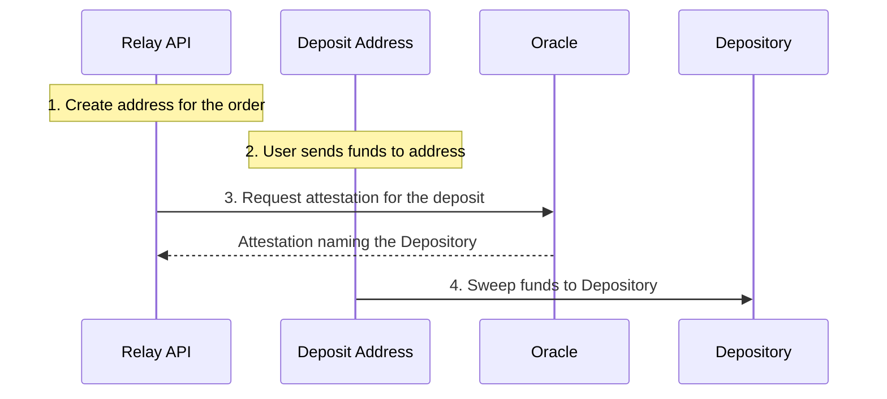

## Overview

Deposit Addresses let users bridge funds by sending tokens to an address, with no wallet connection, calldata, or approval transactions. Relay sweeps each deposit into the [Depository](/references/protocol/components/depository) for the order it funds. Fills and refunds then settle from the Depository like any other deposit. Deposit addresses are non-custodial: Relay never holds their keys, and funds can only be swept into the Depository. See [Non-Custodial Design](#non-custodial-design).

<Info>
For API integration details and usage examples, see the [Deposit Addresses feature guide](/features/deposit-addresses).
</Info>

## How It Works

The flow has three phases: address creation, deposit, and sweep.

### Deposit

The user sends tokens directly to the address with a standard transfer. The funds stay at the address until they are swept.

### Sweep

When Relay detects a deposit, the [Oracle](/references/protocol/components/oracle) attests that the deposit is registered to an order and names the approved Depository. Relay then sweeps the deposited amount into that Depository.

If the sweep fails, the funds stay at the address and can be swept again. Refunds follow the same path: the funds are swept into the Depository first and then paid out to the refund address.

## Non-Custodial Design

Deposit addresses are non-custodial. Relay never holds the private key for a deposit address and can't move the funds to an address of its choosing.

- **No one holds the key.** Each address is derived for its order, and its private key only exists inside a signer running in a trusted execution environment (TEE). The key never leaves the TEE.
- **Funds can only be swept into the Depository.** The signer signs a sweep only when it has a valid Oracle attestation for the order and the transaction deposits the attested amount into the approved Depository, under the order's depositor and order id. It won't sign a transfer to an address the order doesn't specify.
- **Funds stay recoverable.** Once swept, the deposit is secured by the protocol like any other Depository deposit. If the order can't be filled, it's refunded. If the refund can't be paid out automatically, the order's `refundTo` or `recoveryAddress` can [withdraw the funds](/references/protocol/guides/withdrawals) directly.

## Multi-Token and Multi-Deposit Support

A single address can receive several deposits and different supported tokens. Relay sweeps each deposit separately, with its own order. Tokens that aren't supported for deposit addresses are never swept.
